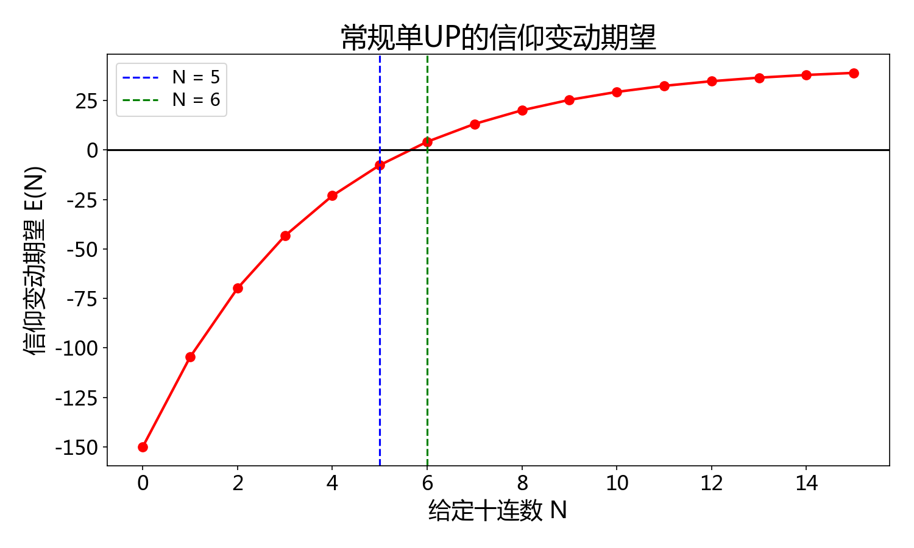
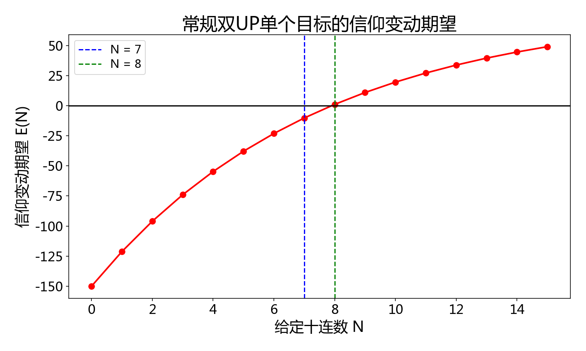
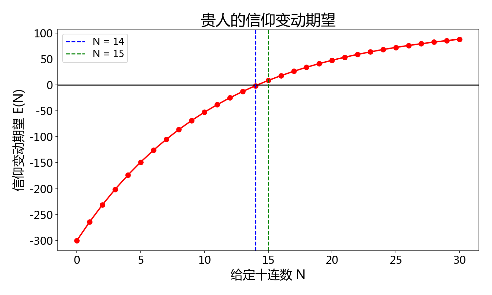
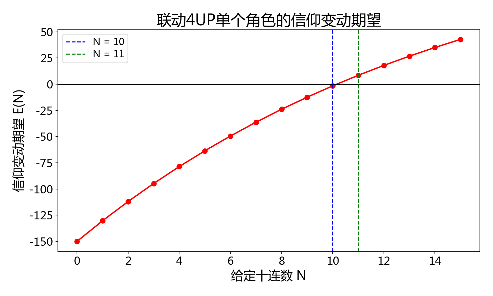
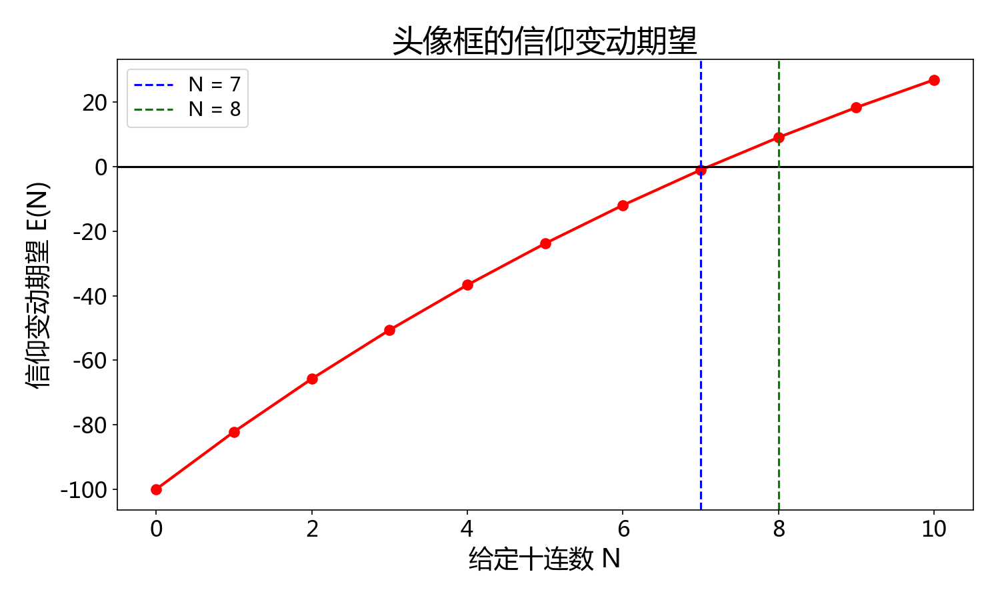
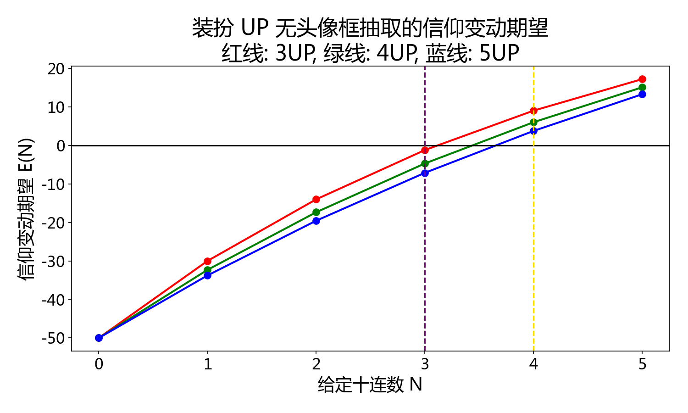
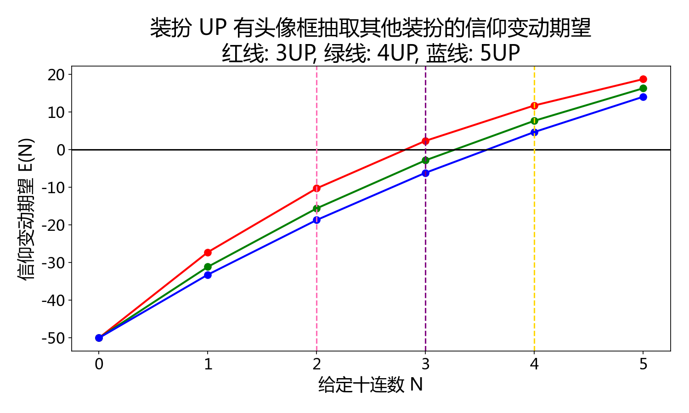

# 【雀魂】卡池抽卡概率与规划详解

**提示: 阅读本专栏需要扎实的概率论基础**

## 前言

本专栏参考了B站UP [冷暖自知_QvQ](https://space.bilibili.com/15498290) 的一系列视频(如 [「雀魂」贵人抽卡策略（理论部分）数学不好者慎入！](https://www.bilibili.com/video/BV1oaYzzzEdW))

考虑到上述视频有些地方考虑不全面, 加上硬核内容以图文方式的讲解效果要比视频好(小论文), 于是就有了此专栏

## 前提知识

### 抽卡概率

1. 雀魂抽卡获得的东西分为三大类, 分别是角色(5%), 装扮(15%), 以及礼物(80%), 本专栏只考虑角色和装扮, 5%和15%分别是它们的基础概率
2. 除了贵人外, 如果抽卡的池子有角色UP, 则UP的角色占角色基础概率的59%(即 5% * 59% = 2.95%), 如果UP的角色不止一位, 则UP的角色均分这59%的UP概率
3. 对于贵人, UP的角色占角色基础概率的20%(即 5% * 20% = 1%), 贵人UP只有一次机会, 且是单UP, 所以贵人角色的概率固定为1%
4. 对于装扮, UP的装扮占装扮基础概率的49%(即 15% * 49% = 7.35%)
    - 如果UP装扮中没有头像框, 则UP的装扮均分这49%的UP概率
    - 如果UP装扮中有头像框, 则头像框固定分走49%其中的6%(减法, 即 15% * 6% = 0.9%), 其他UP装扮均分剩余43%的UP概率(即 15% * 43% = 6.45%)

### 信仰

1. 信仰是雀魂抽卡的最终保底(井), 数量关系与抽数完全一比一对应, 不同池子之间共享并可以继承
2. 对于角色, 除了贵人角色是300信仰之外, 其他角色(常驻和联动)都是150信仰
3. 对于装扮, 除了头像框是100信仰之外, 其他装扮都是50信仰

### 辉玉十连与单抽九次的区别

由于雀魂抽卡说明中有"辉玉十连必定获得一个紫礼物", 所以就抽角色或装扮而言, **辉玉十连的有效抽数是九抽**,
这也与十连的辉玉消耗量(1800)是单抽(200)的九倍对应

故辉玉十连相比单抽九次只有以下优势:

- 信仰数量多一点
- 紫礼物数量多一个

### 雀魂福利很差

为什么要说这个呢, 那是因为这一点使得玩家攒单抽券非常困难, 借此很难凑够"有资格做规划"的抽数, 所以, 以下大部分分析是基于使用辉玉抽卡的, 准确的说, 是基于**使用辉玉十连抽卡**的, 因为上面提到了辉玉十连比同价格的辉玉单抽要多一信仰, 长期来看是更有利的

---

下面进入正文

## 新概念: 信仰变动期望

### 定义

假设我们拥有足够多的信仰, 在给定的抽数限制的情况下, 一定要获取到某个角色或装扮(统称目标)时, 分为两种情况:

1. 在给定抽数内抽到, 此时我们既获得了目标, 又获得了抽卡对应的信仰, 此时信仰相比于我们还没有开抽时, 变动就是正的
2. 在给定抽数内没有抽到, 此时我们只能通过消耗信仰的方式强换目标, 此时信仰相比于我们还没有开抽时, 如果给定抽数小于目标的信仰价格, 变动就是负的, 如果大于, 变动就是正的. 正常情况下都是负的

以上两种情况是**对立事件**, 且各种情况的出现的概率与**给定抽数, 目标的概率, 目标的信仰价格**有关, 因此, 我们可以在给定抽数的情况下, 通过目标的概率和信仰价格, 计算一定要获取到目标的**信仰变动期望**, 以此来评估在长期按照此策略抽卡时, 信仰的变动趋势

记给定抽数为 $G$, 目标命中概率为 $P$, 目标的信仰价格为 $C$, 抽卡获得的信仰为 $A$, 信仰变动期望为 $E$. 在当前一比一的换算下, $A=G$

信仰变动期望的简化数学模型就是一个三元函数:

$$
G, P, C \Rightarrow E
$$

具体到上述两种情况的话, 在给定抽数的情况下, 信仰变动期望的计算公式就是:

$$
E = A \times P + (A-C) \times (1-P)
$$

因为抽数和信仰是完全一比一对应的, 所以上述公式中的"抽卡获得的信仰" $A$ 本质上是"给定抽数" $G$, 即

$$
E = G \times P + (G-C) \times (1-P)
$$

上述内容有点枯燥, 下面举个例子

### 例子

我们的目标是在一个常规单UP池中获得一个UP的常驻角色, 即目标的信仰价格是150, 概率为 5% * 59% = 2.95%

若我们给定抽数为0, 则我们无法抽卡, 只能通过消耗150信仰的方式强换目标, 这种情况下获取目标的信仰变动期望就是

$$
0 \times 0 + (0-150) \times 1 = -150
$$

若我们给定抽数为150, 设我们在150抽内抽到目标的概率为 $P_{150}$ (这个值通过 2.95% 计算得来), 没有抽到的概率自然为 $1-P_{150}$, 这种情况下获取目标的信仰变动期望就是

$$
150P_{150} + (150-150)(1-P_{150}) = 150P_{150}
$$

## 公式的优化

在上述给定抽数为150的例子中, 聪明的同学可能发现一个问题, 就是在150抽内抽到目标的情况时, 没有考虑抽中就收手的情况, 也就是说, 上述公式的计算是基于"无论抽到目标与否, 都会抽满150抽"的假设的, 这很明显不符合现实情况, 现实是如果我们在150抽内抽到目标了, 就不会继续抽了, 因此, 上述公式中的前半部分, 即定义中的第一种情况的计算, 是不准确的, 它没有考虑提前抽到就停止抽取的情形, 所以我们要对上述公式进行优化, 以更准确地反映现实情况.

上述现实的情况应该怎么分析计算呢, 我们可以把在n抽内抽到目标的情况, 细分为在第0抽抽到(概率始终为0), 在第1抽抽到, 在第2抽抽到, ..., 在第n抽抽到, 每一种情况的概率都是可以计算的, 因此, 我们就可以通过计算每一种情况的概率和对应的信仰变动来计算出更准确的信仰变动期望

记给定抽数为 $M$, 第 $n$ 抽首次命中的概率为 $u_n$, 截至第 $M$ 抽仍未命中的概率为 $v_M$, 则优化后的公式如下:

$$
E = \sum_{n=0}^{M} n u_n + (M-C) v_M
$$

除此以外, 上述公式还有问题没考虑到, 就是之前提到的

1. 雀魂的辉玉十连的有效抽数是九抽
2. 对于大众玩家来说, 只有使用辉玉抽卡才有资格做规划
3. 辉玉十连比单抽九次多一个信仰, 长期更有利

因此, "给定抽数"应该改为"给定十连数", "在第n抽抽到的概率"应该改为"在第n次十连内抽到的概率". 记给定十连数为 $N$, 第 $n$ 次十连首次命中的概率为 $u_n$, 完成 $N$ 次十连仍未命中的概率为 $v_N$, 则最终优化后的公式如下: 

$$
\boxed{E = \sum_{n=0}^{N} 10n u_n + (10N-C) v_N}
$$

### 巩固练习

下面趁热打铁, 做个计算题:

> 目标是常规单UP池中获得UP角色, 即信仰价格 150, 概率 2.95%, 现在给定十连数5次, 计算信仰变动期望.

我们先对数据处理一下, 因为题目中的概率是针对"单抽"的, 而不是针对"十连"的, 因此, 我们需要把单抽概率转换为十连内至少抽到一次的概率. 记单抽命中概率为 $p_1$, 单次十连至少命中一次的概率为 $p_{10}$, 计算过程如下(注意十连有效抽数是九抽):

$$
p_{10} = 1 - (1-p_1)^9 = 1 - (1-0.0295)^9 \approx 0.236
$$

我们先计算比较简单的第二部分, 即"没有抽到"的部分, 记 $v_5$ 为 5 次十连均未命中的概率, 则

$$
v_5 = (1-p_{10})^5 = (1-0.236)^5 \approx 0.26
$$

所以公式中的第二部分, 即"没有抽到"的部分, 就是: $(5 \times 10 - 150) \times 0.26 = -26$

下面计算第一部分, 即"抽到"的部分, 我们需要计算在第1次十连抽到的概率, 在第2次十连抽到的概率, ..., 在第5次十连抽到的概率(第0次固定为0就不算了), 以及各种情况下的信仰变动:

- 在第1次十连抽到的概率: $p_{10}$, 对应信仰变动为 10, 所以这一部分的贡献为 $10p_{10}$
- 在第2次十连抽到的概率: $p_{10}(1-p_{10})$, 对应信仰变动为 20, 贡献为 $20p_{10}(1-p_{10})$
- 在第3次十连抽到的概率: $p_{10}(1-p_{10})^2$, 对应信仰变动为 30, 贡献为 $30p_{10}(1-p_{10})^2$
- 在第4次十连抽到的概率: $p_{10}(1-p_{10})^3$, 对应信仰变动为 40, 贡献为 $40p_{10}(1-p_{10})^3$
- 在第5次十连抽到的概率: $p_{10}(1-p_{10})^4$, 对应信仰变动为 50, 贡献为 $50p_{10}(1-p_{10})^4$

左边是一个几何分布模型, 右边贡献的求和, 如果是手算的话, 可以使用高中的等比数列求和的错位相减法, 然后把 $p_{10}$ 带入, 更方便的方式是直接使用数学软件或编程语言求和, 结果为:

$$
10p_{10} + 20p_{10}(1-p_{10}) + 30p_{10}(1-p_{10})^2 + 40p_{10}(1-p_{10})^3 + 50p_{10}(1-p_{10})^4 \approx 18.33
$$

两部分相加, 就得到了最终的信仰变动期望:

$$
18.33 - 26 = -7.67
$$

这个数字说明, 如果以后遇到相同情况, 即目标概率为2.95%, 目标信仰价格为150, 只给定十连数为5次, 抽到就停手, 抽不到就用信仰兑换, 那么按照这个策略抽卡, 长期来看, 信仰总数量是在缓慢下降的, 每次损失大约7.67信仰, 但不是很多, 十连数稍微再加一, 信仰变动期望说不定就会变成正的了

---

再来一道思考题

> 如果我们对公式没有完全优化, 考虑到了"十连的有效抽数是九抽"的情况, 只少了"抽到就停手"的情况, 那么据此公式计算的信仰变动期望结果, 与完全优化后的相比, 是偏高还是偏低?

答: 偏高, 因为没有考虑到抽到就停手的情况, 也就是说, 没有考虑到在抽到目标后, 就不继续抽了, 这就导致了在抽到目标的情况下, 信仰变动被高估了, 因此, 最终计算出来的信仰变动期望结果是偏高的, 更进一步说, 这种偏高是浪费抽数导致的

## 雀魂中的各种情形

目前雀魂中抽卡的情形主要有以下几种:

### 抽角色

1. 常规单UP模型 (2.95%)
2. 常规双UP模型 (二均分2.95%)
3. 贵人模型 (1%)
4. 联动4UP模型 (四均分2.95%)

### 抽装扮

装扮最多5UP, 最少应该是3UP

1. 头像框模型, 抽取头像框 (0.9%)
2. 非头像框装扮模型
    1. UP装扮中没有头像框, UP装扮数量 (均分7.35%): 3, 4, 5个
    2. UP装扮中有头像框, 除去头像框的UP装扮数量 (均分6.45%): 2, 3, 4个

### 分析说明

由于涉及到多目标抽取的分析难度会上升几个层级(如抽取特定两个UP角色), 需要使用多状态的马尔科夫过程来分析, 已经超出了本专栏的范围, 因此, 下面主要分析抽取目标为一个(角色或装扮)的情况, 对于两个及更多个目标的情况, 可以参考下一篇专栏.

## 情形逐个分析

### 常规单UP模型

这种情况最简单, 之前也分析过了, 概率 0.0295, 信仰价格 150, 可得

- 单次十连抽到的概率: 0.236
- 硬抽期望抽数(按十连有效9抽折算, 单位为抽): 37.66

注: 这里的"硬抽期望抽数"按 $\frac{1}{p} \times \frac{10}{9}$ 计算, 即把首次命中所需的期望有效抽数换算成花费的抽数(信仰数), 不是十连次数. 由于十连不能中途停手, 若严格按整次十连计算, 期望抽数为 $\frac{10}{p_{10}}$ (常规单UP约为 42.33 抽), 会略高于上面的值, 下文各模型同理

唯一变数"给定十连数"与"信仰变动期望"的表格与折线图:

| 十连数 | 变动期望 |
| :----: | :------: |
|   0    | -150.00  |
|   1    | -104.56  |
|   2    |  -69.86  |
|   3    |  -43.36  |
|   4    |  -23.12  |
|   5    |  -7.66   |
|   6    |   4.15   |
|   7    |  13.17   |
|   8    |  20.06   |
|   9    |  25.32   |
|   10   |  29.34   |
|   11   |  32.41   |
|   12   |  34.75   |
|   13   |  36.54   |
|   14   |  37.91   |
|   15   |  38.95   |

注意之前分析5次十连数时与表格中的结果差了0.01, 这是数字提前舍入导致的, 没啥影响

信仰变动期望由负转正附近的两个十连数比较重要, 定义为"临界十连数", 在这里是 5 和 6, 这两个十连数的意义就是:

- 5: 5次十连抽到停手, 没抽到就换, 信仰总数量是在缓慢下降的, 每次损失大约7.66信仰, 但因为损失不大, 也是可以接受的
- 6: 6次十连抽到停手, 没抽到就换, 信仰总数量是在缓慢上升的, 每次增加大约4.15信仰, 但时间长了信仰会花不完, 需要另外消耗

5 和 6 的一正一负正好形成互补的关系

### 常规双UP模型

概率 0.0295 / 2 = 0.01475, 信仰价格 150

- 单次十连抽到的概率: 0.125
- 硬抽期望抽数(按十连有效9抽折算, 单位为抽): 75.33

| 十连数 | 变动期望 |
| :----: | :------: |
|   0    | -150.00  |
|   1    | -121.22  |
|   2    |  -96.05  |
|   3    |  -74.02  |
|   4    |  -54.76  |
|   5    |  -37.90  |
|   6    |  -23.16  |
|   7    |  -10.26  |
|   8    |   1.02   |
|   9    |  10.90   |
|   10   |  19.53   |
|   11   |  27.09   |
|   12   |  33.70   |
|   13   |  39.48   |
|   14   |  44.54   |
|   15   |  48.96   |

临界十连数: 7, 8

### 贵人模型

概率 0.01, 信仰价格300

- 单次十连抽到的概率: 0.086
- 硬抽期望抽数(按十连有效9抽折算, 单位为抽): 111.11

| 十连数 |  变动期望   | 十连数 | 变动期望  |
|:---:|:-------:|:---:|:-----:|
|  0  |  -300.00  | 16  | 17.87 |
|  1  | -264.06 | 17  | 26.32 |
|  2  | -231.22 | 18  | 34.05 |
|  3  | -201.22 | 19  | 41.10 |
|  4  | -173.82 | 20  | 47.55 |
|  5  | -148.79 | 21  | 53.43 |
|  6  | -125.92 | 22  | 58.81 |
|  7  | -105.03 | 23  | 63.73 |
|  8  | -85.95  | 24  | 68.22 |
|  9  | -68.51  | 25  | 72.32 |
| 10  | -52.59  | 26  | 76.06 |
| 11  | -38.04  | 27  | 79.48 |
| 12  | -24.75  | 28  | 82.61 |
| 13  | -12.61  | 29  | 85.47 |
| 14  |  -1.52  | 30  | 88.07 |
| 15  |  8.61   |||

临界十连数: 14, 15

### 联动4UP模型

概率 0.0295 / 4 = 0.007375, 信仰价格 150

- 单次十连抽到的概率: 0.064
- 硬抽期望抽数(按十连有效9抽折算, 单位为抽): 150.66

| 十连数 | 变动期望 |
| :----: | :------: |
|   0    | -150.00  |
|   1    | -130.33  |
|   2    | -111.93  |
|   3    |  -94.72  |
|   4    |  -78.61  |
|   5    |  -63.55  |
|   6    |  -49.45  |
|   7    |  -36.26  |
|   8    |  -23.93  |
|   9    |  -12.38  |
|   10   |  -1.59   |
|   11   |   8.52   |
|   12   |  17.97   |
|   13   |  26.81   |
|   14   |  35.08   |
|   15   |  42.82   |

临界十连数: 10, 11

### 装扮-头像框模型

概率 0.009, 信仰价格 100

- 单次十连抽到的概率: 0.078
- 硬抽期望抽数(按十连有效9抽折算, 单位为抽): 123.46

| 十连数 | 变动期望 |
| :----: | :------: |
|   0    | -100.00  |
|   1    |  -82.19  |
|   2    |  -65.76  |
|   3    |  -50.62  |
|   4    |  -36.67  |
|   5    |  -23.80  |
|   6    |  -11.94  |
|   7    |  -1.01   |
|   8    |   9.07   |
|   9    |  18.36   |
|   10   |  26.93   |

临界十连数: 7, 8

### 装扮-非头像框模型

信仰价格 50

#### UP装扮中没有头像框

UP装扮数量 3, 均分7.35% => 概率 0.0245

- 单次十连抽到的概率: 0.200
- 硬抽期望抽数(按十连有效9抽折算, 单位为抽): 45.35

UP装扮数量 4, 均分7.35% => 概率 0.018375

- 单次十连抽到的概率: 0.154
- 硬抽期望抽数(按十连有效9抽折算, 单位为抽): 60.47

UP装扮数量 5, 均分7.35% => 概率 0.0147

- 单次十连抽到的概率: 0.125
- 硬抽期望抽数(按十连有效9抽折算, 单位为抽): 75.59

| 十连数 | 期望(UP数: 3) | 期望(UP数: 4) | 期望(UP数: 5) |
| :----: | :-----------: | :-----------: | :-----------: |
|   0    |    -50.00     |    -50.00     |    -50.00     |
|   1    |    -30.00     |    -32.31     |    -33.76     |
|   2    |    -13.99     |    -17.35     |    -19.55     |
|   3    |     -1.19     |     -4.68     |     -7.11     |
|   4    |     9.04      |     6.04      |     3.78      |
|   5    |     17.24     |     15.11     |     13.31     |

临界十连数: 3, 4

#### UP装扮中有头像框

总UP装扮数量 3, 非头像框UP装扮数 2, 均分6.45% => 概率 0.03225

- 单次十连抽到的概率: 0.255
- 硬抽期望抽数(按十连有效9抽折算, 单位为抽): 34.45

总UP装扮数量 4, 非头像框UP装扮数 3, 均分6.45% => 概率 0.0215

- 单次十连抽到的概率: 0.178
- 硬抽期望抽数(按十连有效9抽折算, 单位为抽): 51.68

总UP装扮数量 5, 非头像框UP装扮数 4, 均分6.45% => 概率 0.016125

- 单次十连抽到的概率: 0.136
- 硬抽期望抽数(按十连有效9抽折算, 单位为抽): 68.91

| 十连数 | 期望(UP数: 3) | 期望(UP数: 4) | 期望(UP数: 5) |
| :----: | :-----------: | :-----------: | :-----------: |
|   0    |    -50.00     |    -50.00     |    -50.00     |
|   1    |    -27.23     |    -31.12     |    -33.19     |
|   2    |    -10.27     |    -15.59     |    -18.68     |
|   3    |     2.35      |     -2.82     |     -6.13     |
|   4    |     11.75     |     7.68      |     4.70      |
|   5    |     18.75     |     16.32     |     14.06     |

总UP装扮数量为 3 的临界十连数: 2, 3

总UP装扮数量为 4 和 5 的临界十连数: 3, 4

## 总结

1. 通过引入"信仰变动期望"这个概念, 我们可以在给定抽数的情况下, 评估抽取目标的策略对信仰数量的长期影响趋势, 从而指导我们在抽卡时应该抽多少十连比较合理, 比较关键的值为"临界十连数", 即信仰变动期望由负转正的十连数, 在这个十连数附近的抽卡策略, 长期来看信仰变动比较平稳, 不会有太大的损失, 也不会有太大的浪费, 因此, 临界十连数是一个比较合理的抽卡策略的参考值
2. 不同的抽卡情形, 由于目标的概率和信仰价格不同, 导致了临界十连数也不同, 因此, 在抽卡时, 需要根据当前抽卡的情形, 来选择合适的抽卡策略, 以达到比较合理的信仰变动期望
3. 上述抽卡情形的"临界十连数", 特别是角色的"临界十连数"都是不小的, 加上平常攒单抽券比较困难, 也进一步印证了攒单抽券很难"有资格做规划", 抽卡规划终究是氪金玩家的专利

最后来一道应用题:

> 假设我们一共有12个十连, 足够多的信仰, 想要某个特定的联动角色和贵人, 则怎么安排抽数(两个池子各下多少个十连), 才使得信仰变动期望最大呢

> 分析: 如果只有一个池子, 在给定12个十连的情况下, 信仰变动期望是固定的, 没有最大这一说, 但现在有两个池子, 因此, 我们可以在两个池子之间分配这12个十连, 比如在联动池抽5个十连, 在贵人池抽7个十连, 或者在联动池抽6个十连, 在贵人池抽6个十连, 等等, 本质上是一种**交错求和找最大值**的过程, 通过计算每一种分配方式的信仰变动期望, 就可以找到使得信仰变动期望最大的分配方式.

答: 分析各种安排对应的两个池子的十连数, 查表得到对应的信仰变动期望, 求二者之和为总期望, 找到最大值即可

| 联动池十连数 | 联动池期望 | 贵人池十连数 | 贵人池期望 |   总期望    |
| :----------: | :--------: | :----------: | :--------: | :---------: |
|      0       |  -150.00   |      12      |   -24.75   |   -174.75   |
|      1       |  -130.33   |      11      |   -38.04   |   -168.37   |
|      2       |  -111.93   |      10      |   -52.59   |   -164.52   |
|    **3**     | **-94.72** |    **9**     | **-68.51** | **-163.23** |
|      4       |   -78.61   |      8       |   -85.95   |   -164.56   |
|      5       |   -63.55   |      7       |  -105.03   |   -168.58   |
|      6       |   -49.45   |      6       |  -125.92   |   -175.37   |
|      7       |   -36.26   |      5       |  -148.79   |   -185.05   |
|      8       |   -23.93   |      4       |  -173.82   |   -197.75   |
|      9       |   -12.38   |      3       |  -201.22   |   -213.60   |
|      10      |   -1.59    |      2       |  -231.22   |   -232.81   |
|      11      |    8.52    |      1       |  -264.06   |   -255.54   |
|      12      |   17.97    |      0       |  -300.00   |   -282.03   |

由表可得: 在联动池抽3个十连, 在贵人池抽9个十连, 可以使得信仰变动期望最大, 为-163.23

---

以上
