# 【雀魂】卡池抽卡概率与规划详解 (进阶版)

## 前言

本专栏需要前置阅读: [【雀魂】卡池抽卡概率与规划详解](https://www.bilibili.com/opus/1214907713917550612)

此外, 阅读本专栏的门槛更高, **需要更加扎实的概率论基础, 乃至随机过程初步**, 至少要**熟悉马尔科夫过程**

(如果之前没有了解随机过程, 那本专栏也可以当成是一个"入门"的实例分析)

## 前情回顾

沿用前文记号: $E$ 为信仰变动期望, $N$ 为给定十连数, $u_n$ 为第 $n$ 次十连首次命中的概率, $v_N$ 为完成 $N$ 次十连仍未命中的概率, $C$ 为信仰价格. 上一篇专栏给出的最终公式为:

$$
\boxed{E = \sum_{n=0}^{N} 10n u_n + (10N-C) v_N}
$$

上述公式的由来是基于两种情况的分析:

- **抽到目标**: 在第 $n$ 次十连内抽到目标, 则信仰变动为 $10n$, 其概率为在第 $n$ 次十连内抽到目标的概率
- **没有抽到目标**: 在给定的十连数内都没有抽到目标, 则信仰变动为 $10N-C$, 其概率为在给定的十连数内都没有抽到目标的概率

那么, 对于整个过程, 就只有两种状态, 即**没有获得目标**和**获得目标**, 这两种状态是可以转移的, 具体来说, 初始状态为**没有获得目标**, 在每次十连抽卡后, 都有可能转移到**获得目标**的状态, 也有可能继续停留在**没有获得目标**的状态, 这就产生了分支, 选择哪条支线的概率就取决于转移到对应状态的概率, 此外, 如果在给定的十连数内都没有抽到目标, 则会通过信仰兑换的方式转移到**获得目标**的状态, 这也是一个支线, 选择这条支线的概率就是没有抽到的概率

对应的过程如下:

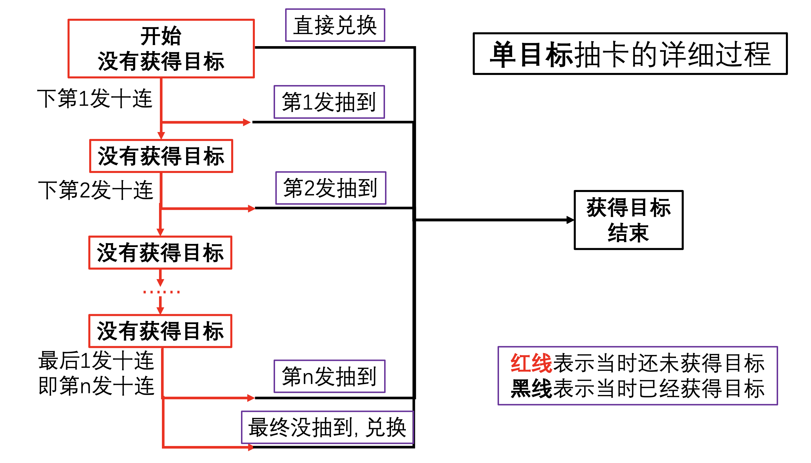

若上述没有获得目标的状态合并为一个状态, 则**没有获得目标**和**获得目标**这两种状态之间的转移的过程, 就是一种典型的**马尔科夫过程**, 上述过程对应的马尔科夫过程如下:

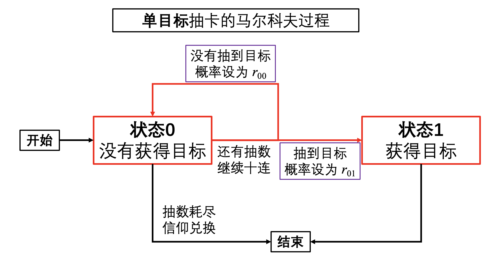

上图中的 $r_{ij}$ 表示在单次十连的情况下, 第 $i$ 状态转到第 $j$ 状态的概率, 其中 $i,j \in \{0,1, ..., n-1\}, i \le j$, 其中 $n$ 为状态数, 在单目标的情况下主要分析 $r_{01}$ 和 $r_{00}$ 两条边, 分别表示单次十连抽到目标和没有抽到目标的概率, 二者和为1, 即若概率为 $p$, 则 $r_{01} = 1 - (1 - p) ^ 9, r_{00} = (1 - p) ^ 9$

上述单目标的情况, 若要扩展为多目标, 就需要在状态空间中增加更多的状态, 例如对于两个目标, 就需要增加一个状态2 $S_2$来表示抽到两个目标的情况, 以此类推, 这样就会导致状态空间非常复杂

下面先就最简单的情况进行详细分析

## 多目标最简单的情形-常规双UP全都要

常规双UP每个角色概率 0.0295 / 2 = 0.01475, 信仰价格 150

马尔科夫过程:

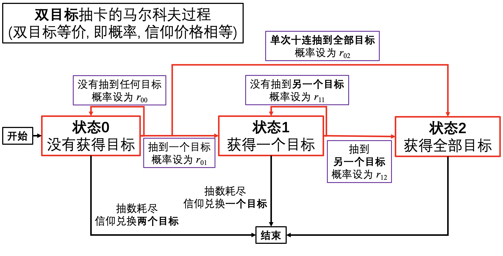

为了使用更通用的方式计算图中的转移概率, 即 $r_{ij}$ 的值, 先定义一些符号:

- $p$ : 抽到单个目标的概率, 即 0.01475
- $q_k$ : 在一次十连抽中, 抽不到 $k$ 个指定目标的概率, 即 $q_k = (1 - k \cdot p) ^ 9$

根据上述马尔科夫过程, 可得:

- $r_{00} = q_2$ : 两个都没抽到 --> 两个都没抽到
- $r_{01} = 2(q_1 - q_2)$ : 两个都没抽到 --> 只抽到其中一个
- $r_{02} = 1 - r_{00} - r_{01} = 1 - q_2 - 2(q_1 - q_2) = 1 - 2q_1 + q_2$ : 两个都没抽到 --> 两个都抽到
- $r_{11} = q_1$ : 只抽到其中一个 --> 只抽到其中一个(没抽到另一个)
- $r_{12} = 1 - r_{11} = 1 - q_1$ : 只抽到其中一个 --> 两个都抽到
- $r_{22} = 1$ : 两个都抽到 --> 两个都抽到 (图中没有画出, 这里补全是为了分析方便)

设 $S_0$ , $S_1$ , $S_2$ 分别表示获得0个目标, 获得1个目标, 获得2个目标的状态, $S_0(N)$, $S_1(N)$, $S_2(N)$ 表示在第 $N$ 次十连抽后处于对应状态的概率, 则定性分析的话, 可以知道: $N > 0$ 时, $S_i(N)$ 只由第 $N-1$ 次十连后的状态分布 $S_j(N-1)$ ($j \le i$) 推导而来, 定量分析的话, 有如下联立式:

$$
\begin{cases}S_0(N) = S_0(N-1) \cdot r_{00} \\ S_1(N) = S_0(N-1) \cdot r_{01} + S_1(N-1) \cdot r_{11} \\ S_2(N) = S_0(N-1) \cdot r_{02} + S_1(N-1) \cdot r_{12} + S_2(N-1)\end{cases}
$$

$r_{ij}$ 用 $q_k$ 带入, 并抽出系数矩阵:

$$
R = \begin{bmatrix}q_2 & 0 & 0 \\ 2(q_1 - q_2) & q_1 & 0 \\ 1 - 2q_1 + q_2 & 1 - q_1 & 1\end{bmatrix}
$$

这就是**马尔科夫链转移概率矩阵**, 表示上一个状态 $S_i(N-1)$ 和当前状态 $S_i(N)$ 的递推关系式, 故

$$
\begin{bmatrix}S_0(N) \\ S_1(N) \\ S_2(N)\end{bmatrix} = R \cdot \begin{bmatrix}S_0(N-1) \\ S_1(N-1) \\ S_2(N-1)\end{bmatrix}
$$

初始条件 $S_0(0) = 1, S_1(0) = 0, S_2(0) = 0$, 递推到初始条件带入得

$$
\begin{bmatrix}S_0(N) \\ S_1(N) \\ S_2(N)\end{bmatrix} = R^N \cdot \begin{bmatrix}1 \\ 0 \\ 0\end{bmatrix}
$$

因此, 通过计算 $R^N$ , 就可以得到在第 $N$ 次十连抽后, 分别获得0个目标, 1个目标, 2个目标的概率, 将上述 $q_k$ 的值计算后带入, 就可以得到数值结果, 获得一个表格:

| $N$  | $S_0(N)$ | $S_1(N)$ | $S_2(N)$ | $N$  | $S_0(N)$ | $S_1(N)$ | $S_2(N)$ |
| :--: | :------: | :------: | :------: | :--: | :------: | :------: | :------: |
|  0   |  1.0000  |  0.0000  |  0.0000  |  16  |  0.0134  |  0.2085  |  0.7781  |
|  1   |  0.7638  |  0.2221  |  0.0141  |  17  |  0.0102  |  0.1854  |  0.8044  |
|  2   |  0.5833  |  0.3639  |  0.0527  |  18  |  0.0078  |  0.1645  |  0.8277  |
|  3   |  0.4455  |  0.4479  |  0.1065  |  19  |  0.0060  |  0.1456  |  0.8484  |
|  4   |  0.3403  |  0.4908  |  0.1689  |  20  |  0.0046  |  0.1287  |  0.8667  |
|  5   |  0.2599  |  0.5050  |  0.2351  |  21  |  0.0035  |  0.1136  |  0.8829  |
|  6   |  0.1985  |  0.4995  |  0.3020  |  22  |  0.0027  |  0.1002  |  0.8972  |
|  7   |  0.1516  |  0.4810  |  0.3674  |  23  |  0.0020  |  0.0882  |  0.9097  |
|  8   |  0.1158  |  0.4545  |  0.4297  |  24  |  0.0016  |  0.0776  |  0.9208  |
|  9   |  0.0884  |  0.4233  |  0.4882  |  25  |  0.0012  |  0.0683  |  0.9306  |
|  10  |  0.0675  |  0.3900  |  0.5425  |  26  |  0.0009  |  0.0600  |  0.9391  |
|  11  |  0.0516  |  0.3562  |  0.5923  |  27  |  0.0007  |  0.0527  |  0.9466  |
|  12  |  0.0394  |  0.3230  |  0.6376  |  28  |  0.0005  |  0.0462  |  0.9532  |
|  13  |  0.0301  |  0.2913  |  0.6786  |  29  |  0.0004  |  0.0406  |  0.9590  |
|  14  |  0.0230  |  0.2616  |  0.7155  |  30  |  0.0003  |  0.0356  |  0.9641  |
|  15  |  0.0176  |  0.2339  |  0.7485  |      |          |          |          |

接下来引入信仰, 再对3种状态做分析: 

- $S_0$: 1个都没抽到, 最终需要兑换2个角色, 需要消耗 300 信仰
- $S_1$: 抽到1个角色, 最终需要兑换1个角色, 需要消耗 150 信仰
- $S_2$: 抽到全部角色, 无需兑换, 无需消耗信仰, 信仰变动为正

所以, 这下就可以仿照单目标的分析, 将三种状态的概率带入之前的期望公式中, 就可以得到双目标的信仰变动期望了, 设 $N$ 为给定的十连数, 信仰变动期望为 $E(N)$, 则有:

$$
E(N) = 10 \sum_{n=1}^{N} n \cdot S_2(n) + (10N - 150) \cdot S_1(N) + (10N - 300) \cdot S_0(N)
$$

其中等号右边第一项为"抽到全部角色的情况", 第二项为"抽到一个角色, 另一个用信仰兑换的情况", 第三项为"一个都没抽到, 两个都用信仰兑换的情况"

但这个公式真的正确吗? 聪明的同学应该发现, 这个和上篇专栏推导"单目标抽卡"时的问题一样, 即第一项的概率应该是"恰好在第 $n$ 次抽到", 而不是"在 $n$ 次内抽到", 跟"单目标抽卡"的"抽到就停手"是一个道理, 这种情况在数学上称为**首达概率**, $S_2$ 这种不会转移到其他状态的终止态称为**吸收态**, 计算就很简单, 当次减去上次, 记为恰好在当次发生的概率, 则第一项实际应该是:

$$
10 \sum_{n=1}^{N} n \cdot [S_2(n) - S_2(n-1)]
$$

这个值如果是手动计算, 该怎么计算呢? 稍微有点小巧思, 除了可以直接展开拆分为两个求和, 然后逐项相消以外, 还可以利用**分部求和** (即 Abel 变换) 来化简, 具体来说, 设 $a_n = n, b_n = S_2(n) - S_2(n-1)$, 则

$$
\sum_{n=1}^{N} a_n b_n = a_N \sum_{n=1}^{N} b_n - \sum_{n=1}^{N-1} (a_{n+1} - a_n) \sum_{k=1}^{n} b_k
$$

仿照上式, 带入得

$$
10 \sum_{n=1}^{N} n \cdot [S_2(n) - S_2(n-1)] = 10\left[N \cdot S_2(N) - \sum_{n=1}^{N-1} S_2(n)\right]
$$

加上 $n=0$ 时 $S_2(n) = 0$, 即得到最终的信仰变动期望公式:

$$
\boxed{E(N) = 10\left[N \cdot S_2(N) - \sum_{n=0}^{N-1} S_2(n) + (N - 15) \cdot S_1(N) + (N - 30) \cdot S_0(N)\right]}
$$

$S_0(N), S_1(N), S_2(N)$ 通过上表中的值带入计算求得 $E(N)$

| $N$  | $E(N)$  | $N$  | $E(N)$ |
| :--: | :-----: | :--: | :----: |
|  0   | -300.00 |  16  | 63.90  |
|  1   | -252.45 |  17  | 70.54  |
|  2   | -209.73 |  18  | 76.36  |
|  3   | -171.52 |  19  | 81.47  |
|  4   | -137.44 |  20  | 85.94  |
|  5   | -107.14 |  21  | 89.86  |
|  6   | -80.25  |  22  | 93.30  |
|  7   | -56.43  |  23  | 96.31  |
|  8   | -35.38  |  24  | 98.94  |
|  9   | -16.79  |  25  | 101.25 |
|  10  |  -0.41  |  26  | 103.27 |
|  11  |  14.03  |  27  | 105.04 |
|  12  |  26.73  |  28  | 106.59 |
|  13  |  37.90  |  29  | 107.94 |
|  14  |  47.71  |  30  | 109.13 |
|  15  |  56.33  |      |        |

同样画成图表:

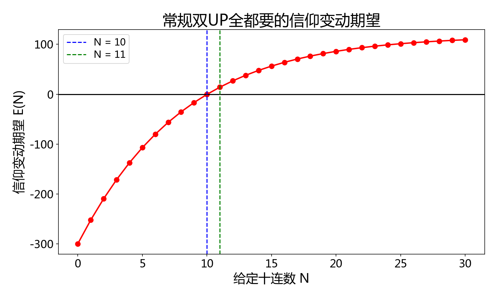

临界十连数: 10, 11

这次, 聪明的同学可能会发现另一个问题, 在"单目标抽取"的分析中, $E(N)$ 随 $N$ 增大而增大, 但增加值 $\Delta E(N)$ 是越来越小的(导数越来越小), 过了"临界十连数"之后 $\Delta E(N)$ 小于10, 可以认为是从这里开始每次多抽的收益不如直接兑换了, 这也与分析的结论一致, 但在"双目标抽取"的分析中, 在过了"临界十连数", 即10和11之后, $\Delta E(N)$ 大于10的效果延续了一段时间, 直到13和14才小于10, 于是就有了两个问题: 

- 在多目标抽取中为什么会出现这种现象?
- 实际抽卡的临界值取10和11, 还是13和14?

篇幅原因, 这部分讲解放到附录1中, 这里先给出结论:

- 多目标抽取中, 引入了更多的状态, 总体收益是多个状态的收益之和, $\Delta E > 10$ 能继续延续是因为在临界点附近, 仍有大量的概率质量分布在 $S_1$ 上, 该状态每次十连抽卡仍有可观的期望收益, 从而将 $\Delta E > 10$ 的区域向后延伸了约 3 次十连
- 仍然是10和11, 单目标的情况只是恰好使得 $E(N)$ 接近 0 的 $N$ 和 $\Delta E(N)$ 接近 10 的 $N$ 重合了, 我们最终想要的是 $E(N)$ 接近 0 的 $N$, 这符合"长期按照此策略信仰变动不大"的策略

以上, 最简单的多目标分析, 即"常规双UP全都要"的分析, 到这里就结束了, 万事开头难, 现在最难的部分已经过去了, 其他多目标的情况也是照葫芦画瓢, 纯粹数据分析, 下面是联动4UP相关的分析

## 联动4UP模型-只要其中特定两个

经过上面的分析, 当前情形其实是非常简单的, 因为也是只要两个角色, 马尔科夫过程一致, 信仰价格也一样, 只是概率砍半 $p=0.0295/4=0.007375$, 其他的分析步骤完全一样, 这里直接给出 $N$ 和 $S_i(N)$ 的表格:

| $N$  | $S_0(N)$ | $S_1(N)$ | $S_2(N)$ | $N$  | $S_0(N)$ | $S_1(N)$ | $S_2(N)$ |
| :--: | :------: | :------: | :------: | :--: | :------: | :------: | :------: |
|  0   |  1.0000  |  0.0000  |  0.0000  |  16  |  0.1177  |  0.4535  |  0.4289  |
|  1   |  0.8748  |  0.1215  |  0.0037  |  17  |  0.1029  |  0.4385  |  0.4585  |
|  2   |  0.7653  |  0.2199  |  0.0148  |  18  |  0.0901  |  0.4228  |  0.4872  |
|  3   |  0.6695  |  0.2987  |  0.0318  |  19  |  0.0788  |  0.4065  |  0.5148  |
|  4   |  0.5857  |  0.3607  |  0.0536  |  20  |  0.0689  |  0.3898  |  0.5412  |
|  5   |  0.5124  |  0.4086  |  0.0790  |  21  |  0.0603  |  0.3731  |  0.5666  |
|  6   |  0.4482  |  0.4445  |  0.1072  |  22  |  0.0527  |  0.3564  |  0.5909  |
|  7   |  0.3921  |  0.4703  |  0.1375  |  23  |  0.0461  |  0.3398  |  0.6141  |
|  8   |  0.3430  |  0.4876  |  0.1693  |  24  |  0.0404  |  0.3235  |  0.6361  |
|  9   |  0.3001  |  0.4979  |  0.2020  |  25  |  0.0353  |  0.3076  |  0.6571  |
|  10  |  0.2625  |  0.5022  |  0.2352  |  26  |  0.0309  |  0.2920  |  0.6771  |
|  11  |  0.2297  |  0.5018  |  0.2686  |  27  |  0.0270  |  0.2770  |  0.6960  |
|  12  |  0.2009  |  0.4973  |  0.3018  |  28  |  0.0236  |  0.2624  |  0.7140  |
|  13  |  0.1758  |  0.4897  |  0.3346  |  29  |  0.0207  |  0.2483  |  0.7310  |
|  14  |  0.1538  |  0.4795  |  0.3668  |  30  |  0.0181  |  0.2349  |  0.7471  |
|  15  |  0.1345  |  0.4672  |  0.3983  |      |          |          |          |

同样得到 $N$ 和 $E(N)$ 的图表:

| $N$  | $E(N)$  | $N$  | $E(N)$ |
| :--: | :-----: | :--: | :----: |
|  0   | -300.00 |  16  | 29.64  |
|  1   | -270.66 |  17  | 42.01  |
|  2   | -242.61 |  18  | 53.65  |
|  3   | -215.84 |  19  | 64.61  |
|  4   | -190.32 |  20  | 74.91  |
|  5   | -166.05 |  21  | 84.60  |
|  6   | -142.98 |  22  | 93.71  |
|  7   | -121.09 |  23  | 102.26 |
|  8   | -100.33 |  24  | 110.30 |
|  9   | -80.68  |  25  | 117.85 |
|  10  | -62.09  |  26  | 124.93 |
|  11  | -44.51  |  27  | 131.58 |
|  12  | -27.90  |  28  | 137.82 |
|  13  | -12.23  |  29  | 143.68 |
|  14  |  2.56   |  30  | 149.17 |
|  15  |  16.50  |      |        |

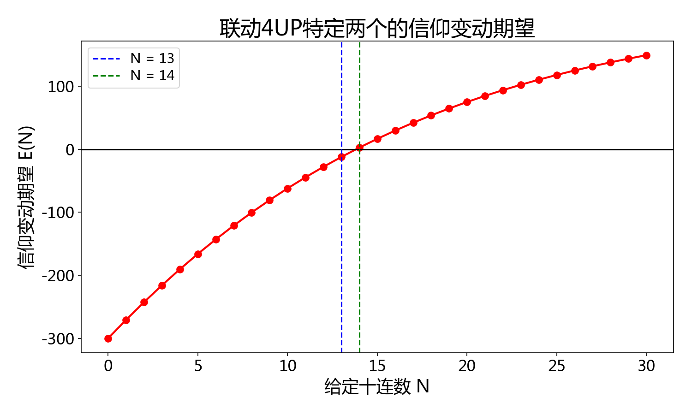

临界十连数: 13, 14

## 联动4UP模型-全都要

全都要最终会获得4个角色, 状态空间更大了, 状态需要增加 $S_3$ 和 $S_4$ 来表示抽到3个目标和抽到全部4个目标的情况, 马尔科夫过程如下:

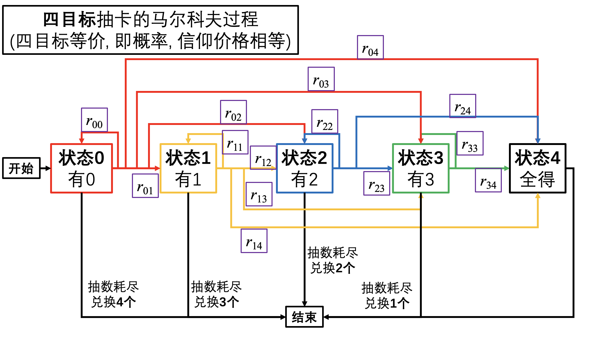

可以发现, 多的两个状态会使状态转移变得非常复杂, 这也是一般情况下能接触到的最复杂情况, 为了方便分析, 这里重新整理一下定义的符号:

- $p$ : 抽到单个目标的概率, 即 0.007375
- $q_k$ : 在一次十连抽中, 抽不到 $k$ 个指定目标的概率, 即 $q_k = (1 - k \cdot p) ^ 9$
- $S_i$ : 已拥有 $i$ 个不同目标的状态, $i \in \{0,1,2,3,4\}$
- $S_i(N)$ : 在第 $N$ 次十连抽后处于状态 $S_i$ 的概率, $i \in \{0,1,2,3,4\}$

根据上述马尔科夫过程, 可得(这部分的计算需要用到**容斥原理**):

- $r_{00} = q_4$ : 四个都没抽到 --> 四个都没抽到
- $r_{01} = 4(q_3 - q_4)$ : 四个都没抽到 --> 只抽到其中一个
- $r_{02} = 6(q_2 - 2q_3 + q_4)$ : 四个都没抽到 --> 只抽到其中两个
- $r_{03} = 4(q_1 - 3q_2 + 3q_3 - q_4)$ : 四个都没抽到 --> 只抽到其中三个
- $r_{04} = 1-r_{00}-r_{01}-r_{02}-r_{03} = 1 - 4q_1 + 6q_2 - 4q_3 + q_4$ : 四个都没抽到 --> 四个都抽到
- $r_{11} = q_3$ : 只抽到其中一个 --> 只抽到其中一个(没抽到另三个)
- $r_{12} = 3(q_2 - q_3)$ : 只抽到其中一个 --> 只抽到其中两个
- $r_{13} = 3(q_1 - 2q_2 + q_3)$ : 只抽到其中一个 --> 只抽到其中三个
- $r_{14} = 1 - r_{11} - r_{12} - r_{13} = 1 - 3q_1 + 3q_2 - q_3$ : 只抽到其中一个 --> 四个都抽到
- $r_{22} = q_2$ : 只抽到其中两个 --> 只抽到其中两个(没抽到另两个)
- $r_{23} = 2(q_1 - q_2)$ : 只抽到其中两个 --> 只抽到其中三个
- $r_{24} = 1 - r_{22} - r_{23} = 1 - 2q_1 + q_2$ : 只抽到其中两个 --> 四个都抽到
- $r_{33} = q_1$ : 只抽到其中三个 --> 只抽到其中三个(没抽到最后一个)
- $r_{34} = 1 - r_{33} = 1 - q_1$ : 只抽到其中三个 --> 四个都抽到
- $r_{44} = 1$ : 四个都抽到 --> 四个都抽到 (图中没有画出, 这里补全是为了分析方便)

递推联立式:

$$
\begin{cases}S_0(N) = S_0(N-1)r_{00} \\ S_1(N) = S_0(N-1)  r_{01} + S_1(N-1)  r_{11} \\ S_2(N) = S_0(N-1)  r_{02} + S_1(N-1)  r_{12} + S_2(N-1)  r_{22} \\ S_3(N) = S_0(N-1)  r_{03} + S_1(N-1)  r_{13} + S_2(N-1)  r_{23} + S_3(N-1)  r_{33} \\ S_4(N) = S_0(N-1)  r_{04} + S_1(N-1)  r_{14} + S_2(N-1)  r_{24} + S_3(N-1)  r_{34} + S_4(N-1)\end{cases}
$$

$r_{ij}$ 用 $q_k$ 带入, 马尔科夫链转移概率矩阵:

$$
R = \begin{bmatrix}q_4 & 0 & 0 & 0 & 0 \\ 4(q_3 - q_4) & q_3 & 0 & 0 & 0 \\ 6(q_2 - 2q_3 + q_4) & 3(q_2 - q_3) & q_2 & 0 & 0 \\ 4(q_1 - 3q_2 + 3q_3 - q_4) & 3(q_1 - 2q_2 + q_3) & 2(q_1 - q_2) & q_1 & 0 \\ 1 - 4q_1 + 6q_2 - 4q_3 + q_4 & 1 - 3q_1 + 3q_2 - q_3 & 1 - 2q_1 + q_2 & 1 - q_1 & 1\end{bmatrix}
$$

初始条件 $S_0(0) = 1, S_1(0) = 0, S_2(0) = 0, S_3(0) = 0, S_4(0) = 0$, 递推到初始条件带入得

$$
\begin{bmatrix}S_0(N) \\ S_1(N) \\ S_2(N) \\ S_3(N) \\ S_4(N)\end{bmatrix} = R^N \cdot \begin{bmatrix}1 \\ 0 \\ 0 \\ 0 \\ 0\end{bmatrix}
$$

数值带入, 得到表格:

| $N$ | $S_0(N)$ | $S_1(N)$ | $S_2(N)$ | $S_3(N)$ | $S_4(N)$ | $N$ | $S_0(N)$ | $S_1(N)$ | $S_2(N)$ | $S_3(N)$ | $S_4(N)$ |
|:---:|:--------:|:--------:|:--------:|:--------:|:--------:|:---:|:--------:|:--------:|:--------:|:--------:|:--------:|
|  0  |  1.0000  |  0.0000  |  0.0000  |  0.0000  |  0.0000  | 16  |  0.0134  |  0.1059  |  0.3079  |  0.3905  |  0.1823  |
|  1  |  0.7638  |  0.2154  |  0.0201  |  0.0007  |  0.0000  | 17  |  0.0102  |  0.0895  |  0.2878  |  0.4039  |  0.2086  |
|  2  |  0.5833  |  0.3406  |  0.0699  |  0.0060  |  0.0002  | 18  |  0.0078  |  0.0754  |  0.2673  |  0.4137  |  0.2358  |
|  3  |  0.4455  |  0.4042  |  0.1313  |  0.0181  |  0.0009  | 19  |  0.0060  |  0.0633  |  0.2470  |  0.4203  |  0.2634  |
|  4  |  0.3403  |  0.4264  |  0.1932  |  0.0375  |  0.0026  | 20  |  0.0046  |  0.0530  |  0.2270  |  0.4239  |  0.2914  |
|  5  |  0.2599  |  0.4220  |  0.2490  |  0.0633  |  0.0058  | 21  |  0.0035  |  0.0444  |  0.2078  |  0.4247  |  0.3196  |
|  6  |  0.1985  |  0.4010  |  0.2955  |  0.0941  |  0.0109  | 22  |  0.0027  |  0.0370  |  0.1895  |  0.4231  |  0.3478  |
|  7  |  0.1516  |  0.3706  |  0.3313  |  0.1283  |  0.0182  | 23  |  0.0020  |  0.0308  |  0.1722  |  0.4192  |  0.3758  |
|  8  |  0.1158  |  0.3357  |  0.3565  |  0.1643  |  0.0277  | 24  |  0.0016  |  0.0257  |  0.1559  |  0.4134  |  0.4034  |
|  9  |  0.0884  |  0.2994  |  0.3718  |  0.2007  |  0.0397  | 25  |  0.0012  |  0.0213  |  0.1408  |  0.4060  |  0.4307  |
| 10  |  0.0675  |  0.2638  |  0.3784  |  0.2361  |  0.0541  | 26  |  0.0009  |  0.0177  |  0.1269  |  0.3972  |  0.4573  |
| 11  |  0.0516  |  0.2303  |  0.3777  |  0.2697  |  0.0708  | 27  |  0.0007  |  0.0146  |  0.1141  |  0.3872  |  0.4834  |
| 12  |  0.0394  |  0.1994  |  0.3709  |  0.3007  |  0.0896  | 28  |  0.0005  |  0.0121  |  0.1023  |  0.3762  |  0.5088  |
| 13  |  0.0301  |  0.1715  |  0.3595  |  0.3285  |  0.1104  | 29  |  0.0004  |  0.0100  |  0.0916  |  0.3645  |  0.5334  |
| 14  |  0.0230  |  0.1467  |  0.3445  |  0.3528  |  0.1329  | 30  |  0.0003  |  0.0083  |  0.0819  |  0.3523  |  0.5573  |
| 15  |  0.0176  |  0.1249  |  0.3270  |  0.3735  |  0.1570  |     |          |          |          |          |          |

| $N$ | $E(N)$  | $N$ | $E(N)$ |
|:---:|:-------:|:---:|:------:|
|  0  | -600.00 | 16  | -53.85 |
|  1  | -551.33 | 17  | -32.36 |
|  2  | -505.15 | 18  | -11.98 |
|  3  | -461.31 | 19  |  7.32  |
|  4  | -419.65 | 20  | 25.59  |
|  5  | -380.05 | 21  | 42.87  |
|  6  | -342.40 | 22  | 59.22  |
|  7  | -306.58 | 23  | 74.68  |
|  8  | -272.50 | 24  | 89.27  |
|  9  | -240.09 | 25  | 103.05 |
| 10  | -209.25 | 26  | 116.06 |
| 11  | -179.93 | 27  | 128.33 |
| 12  | -152.06 | 28  | 139.89 |
| 13  | -125.57 | 29  | 150.79 |
| 14  | -100.41 | 30  | 161.06 |
| 15  | -76.52  |     |        |

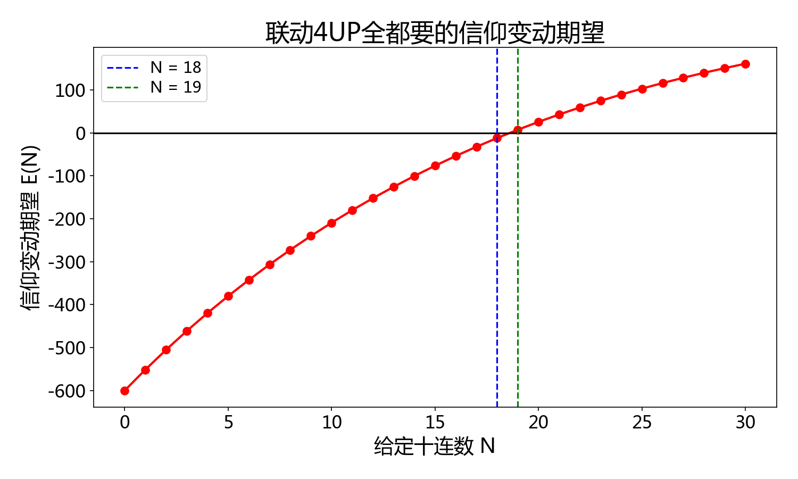

临界十连数: 18, 19

值得一提的是, B站UP"冷暖自知_QvQ"的视频中有通过 Excel 的随机函数来模拟抽卡的实验, 其中联动4UP相关的实验结果与上述理论推导有点出入, 其中有部分是实验原理的区别, 不过碍于篇幅限制, 对冷暖实验的分析报告作为附录2供读者参考.

## 联动4UP模型-只要其中特定三个

这个比上面全都要还要简单一些, 去掉状态 $S_4$, 其他的分析步骤完全一样, 这里直接给出关键步骤:

- $r_{00} = q_3$ : 三个都没抽到 --> 三个都没抽到
- $r_{01} = 3(q_2 - q_3)$ : 三个都没抽到 --> 只抽到其中一个
- $r_{02} = 3(q_1 - 2q_2 + q_3)$ : 三个都没抽到 --> 只抽到其中两个
- $r_{03} = 1 - r_{00} - r_{01} - r_{02} = 1 - 3q_1 + 3q_2 - q_3$ : 三个都没抽到 --> 三个都抽到
- $r_{11} = q_2$ : 只抽到其中一个 --> 只抽到其中一个(没抽到另两个)
- $r_{12} = 2(q_1 - q_2)$ : 只抽到其中一个 --> 只抽到其中两个
- $r_{13} = 1 - r_{11} - r_{12} = 1 - 2q_1 + q_2$ : 只抽到其中一个 --> 三个都抽到
- $r_{22} = q_1$ : 只抽到其中两个 --> 只抽到其中两个(没抽到另一个)
- $r_{23} = 1 - r_{22} = 1 - q_1$ : 只抽到其中两个 --> 三个都抽到
- $r_{33} = 1$ : 三个都抽到 --> 三个都抽到

递推联立式:

$$
\begin{cases}S_0(N) = S_0(N-1) \cdot r_{00} \\ S_1(N) = S_0(N-1) \cdot r_{01} + S_1(N-1) \cdot r_{11} \\ S_2(N) = S_0(N-1) \cdot r_{02} + S_1(N-1) \cdot r_{12} + S_2(N-1) \cdot r_{22} \\ S_3(N) = S_0(N-1) \cdot r_{03} + S_1(N-1) \cdot r_{13} + S_2(N-1) \cdot r_{23} + S_3(N-1)\end{cases}
$$

转移概率矩阵:

$$
R = \begin{bmatrix}q_3 & 0 & 0 & 0 \\ 3(q_2 - q_3) & q_2 & 0 & 0 \\ 3(q_1 - 2q_2 + q_3) & 2(q_1 - q_2) & q_1 & 0 \\ 1 - 3q_1 + 3q_2 - q_3 & 1 - 2q_1 + q_2 & 1 - q_1 & 1\end{bmatrix}
$$

数值带入, 得到表格:

| $N$ | $S_0(N)$ | $S_1(N)$ | $S_2(N)$ | $S_3(N)$ | $N$ | $S_0(N)$ | $S_1(N)$ | $S_2(N)$ | $S_3(N)$ |
|:---:|:--------:|:--------:|:--------:|:--------:|:---:|:--------:|:--------:|:--------:|:--------:|
|  0  |  1.0000  |  0.0000  |  0.0000  |  0.0000  | 16  |  0.0399  |  0.2334  |  0.4468  |  0.2799  |
|  1  |  0.8176  |  0.1716  |  0.0106  |  0.0002  | 17  |  0.0326  |  0.2110  |  0.4468  |  0.3096  |
|  2  |  0.6685  |  0.2904  |  0.0394  |  0.0017  | 18  |  0.0267  |  0.1902  |  0.4440  |  0.3392  |
|  3  |  0.5466  |  0.3688  |  0.0792  |  0.0054  | 19  |  0.0218  |  0.1710  |  0.4387  |  0.3685  |
|  4  |  0.4469  |  0.4164  |  0.1247  |  0.0120  | 20  |  0.0178  |  0.1533  |  0.4315  |  0.3974  |
|  5  |  0.3654  |  0.4410  |  0.1720  |  0.0217  | 21  |  0.0146  |  0.1372  |  0.4225  |  0.4258  |
|  6  |  0.2987  |  0.4485  |  0.2183  |  0.0345  | 22  |  0.0119  |  0.1225  |  0.4120  |  0.4535  |
|  7  |  0.2443  |  0.4436  |  0.2619  |  0.0503  | 23  |  0.0097  |  0.1092  |  0.4005  |  0.4806  |
|  8  |  0.1997  |  0.4300  |  0.3015  |  0.0688  | 24  |  0.0080  |  0.0972  |  0.3880  |  0.5068  |
|  9  |  0.1633  |  0.4104  |  0.3364  |  0.0899  | 25  |  0.0065  |  0.0864  |  0.3749  |  0.5322  |
| 10  |  0.1335  |  0.3871  |  0.3663  |  0.1131  | 26  |  0.0053  |  0.0767  |  0.3613  |  0.5566  |
| 11  |  0.1092  |  0.3615  |  0.3911  |  0.1382  | 27  |  0.0044  |  0.0680  |  0.3474  |  0.5802  |
| 12  |  0.0892  |  0.3350  |  0.4110  |  0.1648  | 28  |  0.0036  |  0.0603  |  0.3333  |  0.6029  |
| 13  |  0.0730  |  0.3084  |  0.4261  |  0.1925  | 29  |  0.0029  |  0.0533  |  0.3192  |  0.6246  |
| 14  |  0.0597  |  0.2823  |  0.4369  |  0.2211  | 30  |  0.0024  |  0.0471  |  0.3051  |  0.6453  |
| 15  |  0.0488  |  0.2572  |  0.4436  |  0.2504  |     |          |          |          |          |

| $N$ | $E(N)$  | $N$ | $E(N)$ |
|:---:|:-------:|:---:|:------:|
|  0  | -450.00 | 16  | -8.63  |
|  1  | -411.00 | 17  |  8.56  |
|  2  | -373.87 | 18  | 24.81  |
|  3  | -338.50 | 19  | 40.16  |
|  4  | -304.80 | 20  | 54.66  |
|  5  | -272.71 | 21  | 68.33  |
|  6  | -242.14 | 22  | 81.23  |
|  7  | -213.03 | 23  | 93.40  |
|  8  | -185.34 | 24  | 104.86 |
|  9  | -159.01 | 25  | 115.65 |
| 10  | -133.99 | 26  | 125.81 |
| 11  | -110.22 | 27  | 135.38 |
| 12  | -87.67  | 28  | 144.38 |
| 13  | -66.27  | 29  | 152.84 |
| 14  | -46.00  | 30  | 160.79 |
| 15  | -26.80  |     |        |

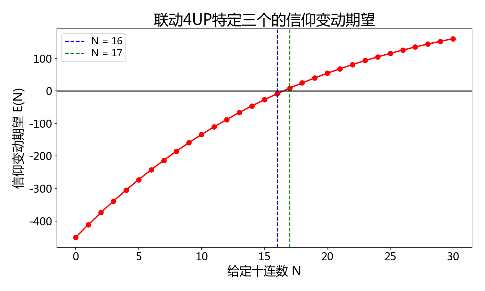

临界十连数: 16, 17

## 混合模型-只要联动4UP的特定角色和头像框装扮

这里就稍微有点不一样了, 即目标不等价, 概率和信仰价格不一样

角色: 概率 0.007375, 信仰价格 150. 头像框装扮: 概率 0.009, 信仰价格 100

先上马尔科夫过程:

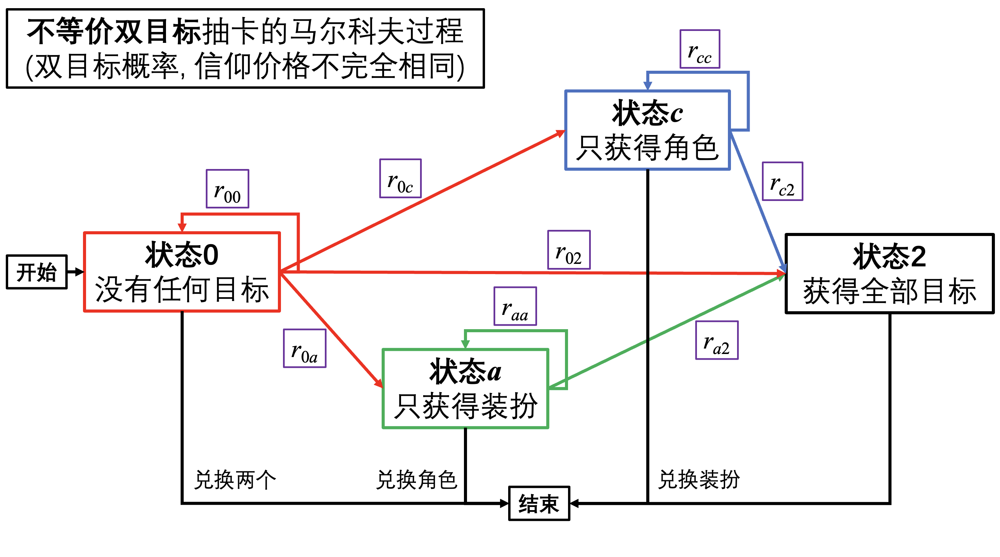

定义符号:

- $p_1$ : 抽到角色的概率, 即 0.007375
- $p_2$ : 抽到头像框装扮的概率, 即 0.009
- $q_c$ : 在一次十连抽中, 抽不到角色的概率, 即 $(1 - p_1) ^ 9$
- $q_a$ : 在一次十连抽中, 抽不到头像框装扮的概率, 即 $(1 - p_2) ^ 9$
- $q_{ca}$ : 在一次十连抽中, 角色和头像框都没抽到的概率, 即 $(1 - p_1 - p_2) ^ 9$
- $S_0$ : 角色和头像框都没有的状态
- $S_a$ : 只有头像框没有角色的状态
- $S_c$ : 只有角色没有头像框的状态
- $S_2$ : 角色和头像框都有的状态(终止态)

根据上述马尔科夫过程, 可得:

- $r_{00} = q_{ca}$ : 角色和头像框都没有 --> 角色和头像框都没有
- $r_{0a} = q_c - q_{ca}$ : 角色和头像框都没有 --> 只有头像框没有角色
- $r_{0c} = q_a - q_{ca}$ : 角色和头像框都没有 --> 只有角色没有头像框
- $r_{02} = 1-r_{00}-r_{0a}-r_{0c} = 1 - q_c - q_a + q_{ca}$ : 角色和头像框都没有 --> 角色和头像框都有
- $r_{aa} = q_c$ : 只有头像框没有角色 --> 只有头像框没有角色(没抽到角色)
- $r_{a2} = 1 - r_{aa} = 1 - q_c$ : 只有头像框没有角色 --> 角色和头像框都有
- $r_{cc} = q_a$ : 只有角色没有头像框 --> 只有角色没有头像框(没抽到头像框)
- $r_{c2} = 1 - r_{cc} = 1 - q_a$ : 只有角色没有头像框 --> 角色和头像框都有
- $r_{22} = 1$ : 角色和头像框都有 --> 角色和头像框都有 (图中没有画出, 这里补全是为了分析方便)

递推联立式:

$$
\begin{cases}S_0(N) = S_0(N-1) \cdot r_{00} \\ S_a(N) = S_0(N-1) \cdot r_{0a} + S_a(N-1) \cdot r_{aa} \\ S_c(N) = S_0(N-1) \cdot r_{0c} + S_c(N-1) \cdot r_{cc} \\ S_2(N) = S_0(N-1) \cdot r_{02} + S_a(N-1) \cdot r_{a2} + S_c(N-1) \cdot r_{c2} + S_2(N-1)\end{cases}
$$

转移概率矩阵:

$$
R = \begin{bmatrix}q_{ca} & 0 & 0 & 0 \\ q_c - q_{ca} & q_c & 0 & 0 \\ q_a - q_{ca} & 0 & q_a & 0 \\ 1 - q_c - q_a + q_{ca} & 1 - q_c & 1 - q_a & 1\end{bmatrix}
$$

数值带入, 得到表格: 

| $N$ | $S_0(N)$ | $S_a(N)$ | $S_c(N)$ | $S_2(N)$ | $N$ | $S_0(N)$ | $S_a(N)$ | $S_c(N)$ | $S_2(N)$ |
|:---:|:--------:|:--------:|:--------:|:--------:|:---:|:--------:|:--------:|:--------:|:--------:|
|  0  |  1.0000  |  0.0000  |  0.0000  |  0.0000  | 16  |  0.0928  |  0.2516  |  0.1792  |  0.4764  |
|  1  |  0.8619  |  0.0736  |  0.0599  |  0.0045  | 17  |  0.0800  |  0.2422  |  0.1708  |  0.5070  |
|  2  |  0.7429  |  0.1323  |  0.1069  |  0.0178  | 18  |  0.0689  |  0.2325  |  0.1622  |  0.5363  |
|  3  |  0.6403  |  0.1785  |  0.1431  |  0.0381  | 19  |  0.0594  |  0.2226  |  0.1537  |  0.5643  |
|  4  |  0.5519  |  0.2142  |  0.1703  |  0.0636  | 20  |  0.0512  |  0.2126  |  0.1452  |  0.5909  |
|  5  |  0.4757  |  0.2410  |  0.1901  |  0.0932  | 21  |  0.0441  |  0.2027  |  0.1370  |  0.6162  |
|  6  |  0.4100  |  0.2605  |  0.2037  |  0.1258  | 22  |  0.0380  |  0.1929  |  0.1289  |  0.6402  |
|  7  |  0.3534  |  0.2739  |  0.2124  |  0.1603  | 23  |  0.0328  |  0.1833  |  0.1211  |  0.6628  |
|  8  |  0.3046  |  0.2823  |  0.2170  |  0.1962  | 24  |  0.0283  |  0.1739  |  0.1136  |  0.6843  |
|  9  |  0.2625  |  0.2865  |  0.2183  |  0.2327  | 25  |  0.0244  |  0.1647  |  0.1064  |  0.7045  |
| 10  |  0.2263  |  0.2874  |  0.2169  |  0.2694  | 26  |  0.0210  |  0.1559  |  0.0996  |  0.7235  |
| 11  |  0.1950  |  0.2855  |  0.2136  |  0.3059  | 27  |  0.0181  |  0.1474  |  0.0931  |  0.7414  |
| 12  |  0.1681  |  0.2815  |  0.2086  |  0.3419  | 28  |  0.0156  |  0.1392  |  0.0869  |  0.7583  |
| 13  |  0.1449  |  0.2757  |  0.2023  |  0.3771  | 29  |  0.0134  |  0.1314  |  0.0810  |  0.7741  |
| 14  |  0.1249  |  0.2686  |  0.1952  |  0.4113  | 30  |  0.0116  |  0.1239  |  0.0755  |  0.7890  |
| 15  |  0.1076  |  0.2605  |  0.1874  |  0.4444  |     |          |          |          |          |

| $N$ | $E(N)$  | $N$ | $E(N)$ |
|:---:|:-------:|:---:|:------:|
|  0  | -250.00 | 16  | 50.31  |
|  1  | -222.52 | 17  | 61.01  |
|  2  | -196.31 | 18  | 71.01  |
|  3  | -171.39 | 19  | 80.37  |
|  4  | -147.73 | 20  | 89.12  |
|  5  | -125.32 | 21  | 97.29  |
|  6  | -104.12 | 22  | 104.93 |
|  7  | -84.10  | 23  | 112.07 |
|  8  | -65.22  | 24  | 118.73 |
|  9  | -47.43  | 25  | 124.95 |
| 10  | -30.69  | 26  | 130.76 |
| 11  | -14.96  | 27  | 136.17 |
| 12  |  -0.18  | 28  | 141.23 |
| 13  |  13.69  | 29  | 145.94 |
| 14  |  26.70  | 30  | 150.34 |
| 15  |  38.89  |     |        |

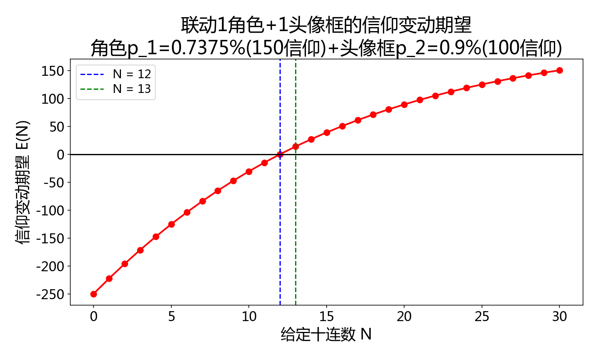

临界十连数: 12, 13

## 联动4UP模型-毕业

毕业是指收集全部角色和装扮(4角色+头像框+4装扮, 也有不含头像框的"4角色+5装扮"情况, 不过大差不差), 也是最复杂的情况, 一共有50个状态, 实在是太复杂了, 这里直接给出 $E(N)$ 的图表和临界十连数:

| $N$ | $E(N)$  | $N$ | $E(N)$ |
|:---:|:-------:|:---:|:------:|
|  0  | -900.00 | 16  | -95.20 |
|  1  | -816.29 | 17  | -68.00 |
|  2  | -739.40 | 18  | -42.39 |
|  3  | -668.59 | 19  | -18.29 |
|  4  | -603.26 | 20  |  4.39  |
|  5  | -542.83 | 21  | 25.74  |
|  6  | -486.81 | 22  | 45.82  |
|  7  | -434.78 | 23  | 64.70  |
|  8  | -386.33 | 24  | 82.46  |
|  9  | -341.14 | 25  | 99.15  |
| 10  | -298.91 | 26  | 114.84 |
| 11  | -259.38 | 27  | 129.57 |
| 12  | -222.31 | 28  | 143.40 |
| 13  | -187.53 | 29  | 156.39 |
| 14  | -154.84 | 30  | 168.57 |
| 15  | -124.11 |     |        |

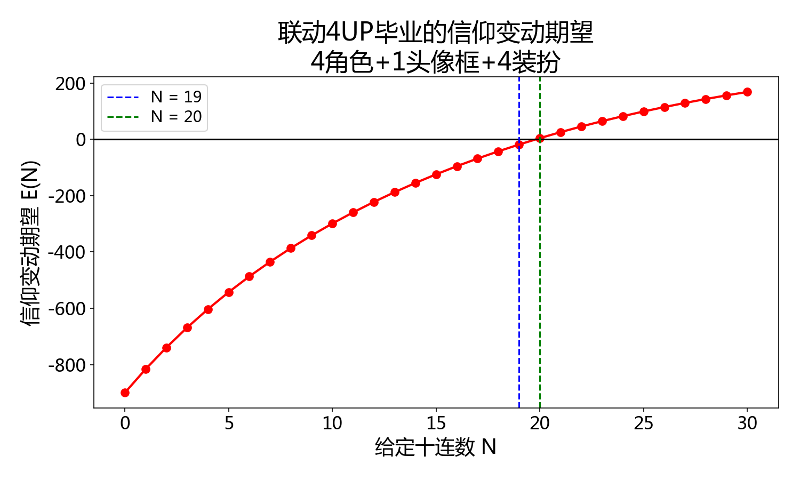

临界十连数: 19, 20

---

多目标的情况种类非常多, 逐个分析是分析不过来的, 而且篇幅也会非常长, 而且临界十连数大差不差, 所以详细分析就到这里, 只要掌握上面马尔科夫链转移概率矩阵推导相关的思路和方法, 就可以分析自己需要的多目标的情况了

## 总结分析

和上篇专栏的数据放在一起

### 单目标

#### 装扮

|      模型      |    概率    | 信仰价格 | 临界十连数 |
|:------------:|:--------:|:----:|:-----:|
|     头像框      |  0.009   | 100  | 7, 8  |
| 无头像框其他装扮-3UP |  0.0245  |  50  | 3, 4  |
| 无头像框其他装扮-4UP | 0.018375 |  50  | 3, 4  |
| 无头像框其他装扮-5UP |  0.0147  |  50  | 3, 4  |
| 有头像框其他装扮-3UP | 0.03225  |  50  | 2, 3  |
| 有头像框其他装扮-4UP |  0.0215  |  50  | 3, 4  |
| 有头像框其他装扮-5UP | 0.016125 |  50  | 3, 4  |

#### 角色

|  模型   |    概率    | 信仰价格 | 临界十连数  |
|:-----:|:--------:|:----:|:------:|
| 常规单UP |  0.0295  | 150  |  5, 6  |
| 常规双UP | 0.01475  | 150  |  7, 8  |
|  贵人   |   0.01   | 300  | 14, 15 |
| 联动4UP | 0.007375 | 150  | 10, 11 |

### 多目标

|          模型           |            概率             |     信仰价格     | 临界十连数  |
|:---------------------:|:-------------------------:|:------------:|:------:|
|       常规双UP-全都要       |          0.01475          |     150      | 10, 11 |
|    联动4UP-只要其中特定两个     |         0.007375          |     150      | 13, 14 |
|    联动4UP-只要其中特定三个     |         0.007375          |     150      | 16, 17 |
|       联动4UP-全都要       |         0.007375          |     150      | 18, 19 |
|   联动4UP-只要特定角色和头像框    |      0.007375, 0.009      |   150, 100   | 12, 13 |
| 联动4UP-毕业(4角色+头像框+4装扮) | 0.007375, 0.009, 0.016125 | 150, 100, 50 | 19, 20 |

### 分析

可以看出, 相比于单目标, 多目标虽然目标多了, 但临界十连数并没有比单目标的情况高出很多, 这主要是因为**信仰自由兑换的机制太超模了**, 其次是因为多目标在前期的抽中至少一个目标的概率还是挺高的(多个目标的概率和), 这就导致瓶颈在后期抽剩下的目标上了, 这个时候信仰自由兑换发力, 使用前期花费掉的抽数当做信仰, 变相降低了后期目标的信仰价格, 使得多目标的临界十连数没有被单目标的情况甩开太多.

最后给出一道练习题, 也算是对上面分析过程的一个训练和应用, 锻炼一下自己可能需要的自定义场景的分析能力:

> 在联动4up模型中, 角色概率0.007375, 装扮为5UP, 假设有头像框, 那么非头像框装扮概率0.016125, 信仰价格50, 现计算目标为"2个特定角色和1个特定非头像框装扮"共3个目标时的临界十连数.

答案是 13, 14. **计算过程比答案重要**

---

# 附录1: 多目标临界点之后 E(N) 邻差为何仍大于 $10$

设 $\Delta E(N) = E(N+1) - E(N)$, 即多抽一次十连带来的期望变动增量. 若 $\Delta E(N) > 10$, 说明第 $N+1$ 次十连带来的额外收益超过了其成本 10(信仰), 这次十连"值得抽".

## 单目标情况 (回顾)

以常规单UP的单目标举例: 概率 0.0295, 信仰价格 150, 单次十连抽到的概率: 0.2362, 硬抽期望抽数(按十连有效9抽折算, 单位为抽): 37.66. 以下用下标 1 表示单目标情形.

单目标时 $S_0(N) = r_{00}^N$(只有"没抽到"一个非吸收态), 直接推导可得:

$$
\Delta E_1(N) = S_0(N) \cdot (10 + r_{01} \cdot 150) = S_0(N) \cdot 45.43
$$

$\Delta E_1(N) > 10$ 当且仅当 $S_0(N) > 0.22$. 而 $S_0(N) = (1-0.2362)^N = 0.7638^N$:

|          $N$          |     5     |   6   |   7   |
|:---------------------:|:---------:|:-----:|:-----:|
|       $S_0(N)$        |   0.260   | 0.199 | 0.152 |
| $\Delta E_1$ | **11.81** | 9.02  | 6.89  |

临界点 $N=6$($E$ 由负转正)恰好与 $\Delta E$ 跌破 $10$ 几乎重合: **一旦过了临界点, 每次多抽的收益立即低于成本**.

## 双目标情况

双目标时存在 $S_0, S_1$ 两个非吸收态. 从 $N$ 到 $N+1$ 多抽一次, 处于 $S_0$ 或 $S_1$ 的路径都可能改善状态, 推得:

$$
\Delta E(N) = 10(S_0(N) + S_1(N)) + S_0(N) \cdot (r_{01} \cdot 150 + r_{02} \cdot 300) + S_1(N) \cdot r_{12} \cdot 150
$$

代入数值 $r_{01} \cdot 150 + r_{02} \cdot 300 \approx 37.55$, $r_{12} \cdot 150 \approx 18.78$, 化简得:

$$
\Delta E(N) > 10 \iff S_0(N) \cdot 47.55 + S_1(N) \cdot 28.78 > 10
$$

双目标各节点:

| $N$ | $S_0(N)$ | $S_1(N)$ | $\Delta E(N)$ | $>10$? |
|:---:|:--------:|:--------:|:-------------:|:------:|
|  9  |  0.0884  |  0.4233  |     16.38     |   ✓    |
| 10  |  0.0675  |  0.3900  |     14.44     |   ✓    |
| 11  |  0.0516  |  0.3562  |     12.70     |   ✓    |
| 12  |  0.0394  |  0.3230  |     11.17     |   ✓    |
| 13  |  0.0301  |  0.2913  |     9.81      |   ✗    |
| 14  |  0.0230  |  0.2616  |     8.62      |   ✗    |

临界点 $N=10$ 之后, $\Delta E$ 仍维持 $>10$ 直到 $N=12 \to 13$, **比单目标多延续了约 3 次十连**.

## 原因分析

令 $B_0(N)=S_0(N)\cdot47.55$, $B_1(N)=S_1(N)\cdot28.78$, 分别表示从 $S_0$ 和 $S_1$ 出发的收益项. 则 $\Delta E(N)$ 由两项构成:

$$
B_0(N)+B_1(N)=S_0(N)\cdot47.55+S_1(N)\cdot28.78
$$

单目标只有第一项(且系数为 $45.43$), 而 $S_0(N)$ 以 $r_{00}^N$ 指数衰减, 越过临界点后迅速缩水, 导致 $\Delta E$ 立即跌破 $10$.

双目标的关键差异在于 **$S_1$ 充当了"缓冲池"**:

- $S_1$ 的衰减速度远慢于 $S_0$: $r_{11} = (1-p)^9 \approx 0.875$, 而 $r_{00} = (1-2p)^9 \approx 0.764$
- $S_1$ 在 $N \approx 5$ 时达到峰值 $\sim 0.50$, 之后缓慢下降, 直到 $N=12$ 时仍有 $\sim 0.32$
- 每条处于 $S_1$ 的路径, 多抽一次仍有 $r_{12} \approx 12.5\%$ 的概率直接命中第二个目标, 节省 $150$ 信仰, 仅此一项就贡献了 $S_1 \cdot 18.78$ 的边际收益

因此, 即使 $E(N)$ 在 $N=10$ 已越过零线(期望已不如直接兑换), **$S_1$ 中残存的概率质量继续让每次额外十连的期望收益高于其成本**, 直到 $S_1$ 衰减至约 $0.29$ 以下($N \approx 13$)才跌破.

## 结论

双目标与单目标在临界点附近的行为差异, 根源在于多目标引入了**中间状态**($S_1$). $S_1$ 衰减速率的降低使得"已经抽到一个, 就差另一个"的路径大量存在, 这些路径上每次十连仍有可观的期望收益, 从而将 $\Delta E > 10$ 的区域**向后延伸了约 3 次十连**.

# 附录2: 冷暖的模拟实验的分析与评价报告

B站UP [冷暖自知_QvQ](https://space.bilibili.com/15498290) 发布的一系列与雀魂抽卡概率详解的视频中, 有提到UP自己做了一些模拟抽卡实验, 然后根据模拟实验的结果来制定抽卡策略, 其中UP重点介绍了对玩家很有参考价值的联动4UP模型, 下面简单介绍一下冷暖的这个模拟实验的内容, 然后进行分析和评价

视频: [「雀魂」一个648能抽几个联动限定？用严谨的数据分析抽卡结果分布情况帮你正确认识雀魂抽卡](https://www.bilibili.com/video/BV1oT42127Kb)

核心截图:

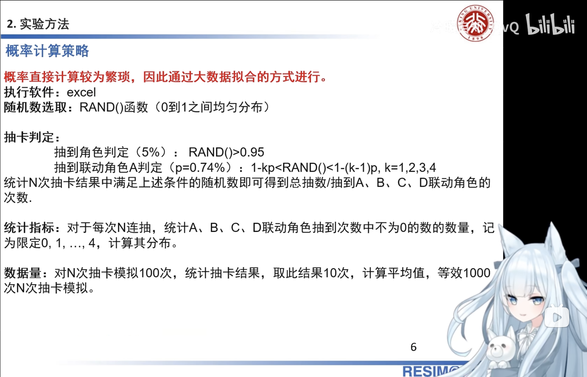

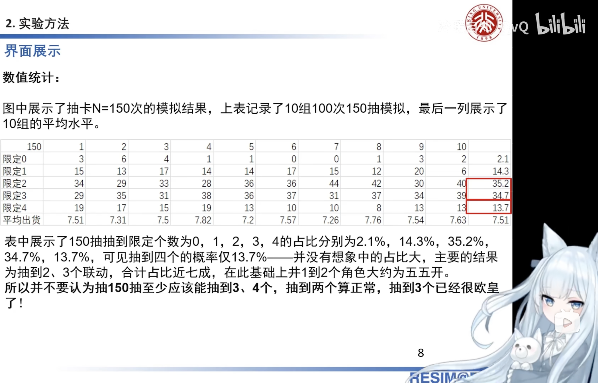

## 实验概览

有一款游戏的抽卡机制如下:

一共有4位角色UP(设为A,B,C,D), 且概率相等, 均为0.007375, 即4位UP角色概率总和为0.0295, 除此以外, 还有0.0205的概率抽到其他角色, 即抽中角色的概率为0.05

为了得到抽卡的理论表现, 进行如下模拟:

- 随机数生成器: Excel 软件的 $RAND()$ 函数, 生成一个 $0-1$ 之间的随机数
- 判定:
    - $RAND() > 0.95$ : 抽中角色, 继续判定抽中哪个角色
        - $1 - 0.007375 < RAND() < 1$ : 抽中A
        - $1 - 0.007375*2 < RAND() < 1 - 0.007375$ : 抽中B
        - $1 - 0.007375*3 < RAND() < 1 - 0.007375*2$ : 抽中C
        - $1 - 0.007375*4 < RAND() < 1 - 0.007375*3$ : 抽中D
        - $0.95 < RAND() < 1 - 0.007375*4$ : 抽中其他角色
- 实验方式: 对上述过程每150次进行一次模拟, 记为1趟, 每100趟为1组, 总共模拟10组
- 统计指标: 每一趟抽到了几个不重复的UP角色(只有0UP, 1UP, 2UP, 3UP, 4UP共5种可能), 每组统计100趟的5种可能的分布

实验结果:

| 组号  | 1  | 2  | 3  | 4  | 5  | 6  | 7  | 8  | 9  | 10 | 平均出现百分比 |
|:---:|:--:|:--:|:--:|:--:|:--:|:--:|:--:|:--:|:--:|:--:|:-------:|
| 0UP | 3  | 6  | 4  | 1  | 1  | 0  | 0  | 1  | 3  | 2  |   2.1   |
| 1UP | 15 | 13 | 17 | 14 | 14 | 17 | 15 | 12 | 20 | 6  |  14.3   |
| 2UP | 34 | 29 | 33 | 28 | 36 | 36 | 44 | 42 | 30 | 40 |  35.2   |
| 3UP | 29 | 35 | 31 | 38 | 36 | 37 | 31 | 37 | 34 | 39 |  34.7   |
| 4UP | 19 | 17 | 15 | 19 | 13 | 10 | 10 | 8  | 13 | 13 |  13.7   |

PS: 需要注意的是, 不能将正文中的联动4UP-全都要的情况与该实验进行对比分析, 因为冷暖的这个实验没有考虑"十连只有九抽"的, 玩家也很难放着十连不抽去一个一个单抽, 有点脱离现实, 但下面的分析过程还是严格按照实验原理进行的

---

## 分析与评价报告

### 一. 实验机制的概率模型

#### 1.1 单次抽取的概率结构

下面的区间表描述的是标称模型: 使用**同一次** $RAND()$, 直接按区间判定结果. 若实现真的先调用一次 $RAND()$ 判断"是否为角色", 再用另一次独立的 $RAND()$ 按这些原始区间判定角色, 则两步并不等价; 第二次调用必须先按条件分布归一化(例如映射到 $(0.95,1]$), 否则 UP 概率会被再次乘以 5%. 由于截图无法确认 Excel 公式是否复用了同一个随机数, 以下理论值只代表标称模型:

|         区间          |  结果  |    概率    |
|:-------------------:|:----:|:--------:|
|    (0.992625, 1)    | UP-A | 0.007375 |
| (0.98525, 0.992625) | UP-B | 0.007375 |
| (0.977875, 0.98525) | UP-C | 0.007375 |
| (0.9705, 0.977875)  | UP-D | 0.007375 |
|   (0.95, 0.9705)    | 其他角色 |  0.0205  |
|      [0, 0.95]      | 未抽中  |   0.95   |

单次抽取中, 各 UP 角色的出现次数服从 **多项分布**:

$$
\text{Multinomial}(1;\; 0.007375, 0.007375, 0.007375, 0.007375, 0.0205, 0.95)
$$

150 次独立抽取后, 各 UP 计数 $(n_A, n_B, n_C, n_D)$ 服从:

$$
\text{Multinomial}(150;\; 0.007375, 0.007375, 0.007375, 0.007375, 0.9705)
$$

由于单次多项分布中各类别互斥, $n_A, n_B, n_C, n_D$ 之间存在**弱负相关性**, 协方差为 $\text{Cov}(n_i, n_j) = -150 \times 0.007375^2 \approx -0.00816$, 可忽略不计.

#### 1.2 理论分布推导(容斥原理)

设 $p = 0.007375$, $N = 150$. 令 $X_k$ 表示指定的 $k$ 个 UP 角色在 $N$ 次抽取中的命中总数, 并定义 $q_k$ 为 $X_k=0$ 的概率:

$$
q_k = (1-k\cdot p)^N = P(X_k=0)
$$

计算得:

- $q_1 = (0.992625)^{150} \approx 0.3294$
- $q_2 = (0.98525)^{150} \approx 0.1076$
- $q_3 = (0.977875)^{150} \approx 0.0349$
- $q_4 = (0.9705)^{150} \approx 0.01118$

由容斥原理:

|  结果  |               公式               |    理论值     |
|:----:|:------------------------------:|:----------:|
| 0 UP |             $q_4$              | **1.12%**  |
| 1 UP |         $4(q_3 - q_4)$         | **9.47%**  |
| 2 UP |     $6(q_2 - 2q_3 + q_4)$      | **29.46%** |
| 3 UP |  $4(q_1 - 3q_2 + 3q_3 - q_4)$  | **39.98%** |
| 4 UP | $1 - 4q_1 + 6q_2 - 4q_3 + q_4$ | **19.98%** |

**期望 UP 种类数**: $E[K] = 4 \times (1 - q_1) = 4 \times 0.6706 = 2.682$

---

### 二. 实验结果的问题

#### 2.1 理论 vs 实验对比

|  类别  |   理论   |  实验   |   偏差    |
|:----:|:------:|:-----:|:-------:|
| 0 UP | 1.12%  | 2.1%  | +0.98pp |
| 1 UP | 9.47%  | 14.3% | +4.83pp |
| 2 UP | 29.46% | 35.2% | +5.74pp |
| 3 UP | 39.98% | 34.7% | −5.28pp |
| 4 UP | 19.98% | 13.7% | −6.28pp |

实验平均 UP 种类数 = $(0\times 21 + 1\times 143 + 2\times 352 + 3\times 347 + 4\times 137) / 1000 = 2.436$, 低于理论值 2.682, **系统性偏低约 9.2%**.

#### 2.2 卡方拟合优度检验

基于总 1000 趟数据(10 组 × 100 趟):

$$
\chi^2 = \sum_{i=0}^{4} \frac{(O_i - E_i)^2}{E_i} = 71.11, \quad df = 4, \quad p \approx 1.3 \times 10^{-14}
$$

在 $\alpha = 0.001$ 水平下临界值约为 18.47, $\chi^2 = 71.11$ 远超此值. **实验分布与理论分布的差异极其显著, 不可能是随机波动所致.**

#### 2.3 偏差模式分析

实验数据的偏差呈现**系统性单向偏移**: 0UP, 1UP, 2UP 均高于理论值, 3UP, 4UP 均低于理论值. 这意味着实验中的**有效 UP 概率低于标称的 0.007375**.

反推有效概率: 若实验平均 UP 种类数 2.436 为真值, 则:

$$
1 - (1 - p_{\text{eff}})^{150} = 2.436 / 4 = 0.609
$$

$$
p_{\text{eff}} = 1 - 0.391^{1/150} \approx 0.00624
$$

有效概率约为标称值的 **84.6%**, 偏差约 15%.

---

### 三. 区间估计

基于 1000 趟总频数, 使用正态近似构建各类别的 95% 置信区间:

$$
\hat{p} \pm z_{0.025} \cdot \sqrt{\frac{\hat{p}(1-\hat{p})}{n}}, \quad z_{0.025} = 1.96
$$

|  类别  |  点估计   |      95% CI      |  理论值   | 覆盖?  |
|:----:|:------:|:----------------:|:------:|:---:|
| 0 UP | 2.10%  |  [1.21%, 2.99%]  | 1.12%  |  ✗  |
| 1 UP | 14.30% | [12.13%, 16.47%] | 9.47%  |  ✗  |
| 2 UP | 35.20% | [32.24%, 38.16%] | 29.46% |  ✗  |
| 3 UP | 34.70% | [31.75%, 37.65%] | 39.98% |  ✗  |
| 4 UP | 13.70% | [11.57%, 15.83%] | 19.98% |  ✗  |

**全部 5 个类别的 95% 置信区间均不覆盖理论值.** 这是实验存在系统性偏差的强有力证据. 即便使用更严格的 99% 置信区间($z=2.576$), 1UP, 2UP, 3UP, 4UP 依然不覆盖理论值, 只有期望频数最低的 0UP([0.93%, 3.27%])覆盖了理论值 1.12%.

各组内变异(组内标准差):

- 0UP: SD = 1.91(均值 2.1), 变异系数 CV = 0.91, 该类别由于期望频数低, 组间波动较大
- 1UP–4UP: SD 在 3.4–5.5 之间, 与二项变异 $\sqrt{100 p(1-p)}$ 的理论预期大致相符

---

### 四. 可能的原因分析

1. **Excel 公式实现错误(可能性较大, 但截图无法确认具体形式)**
    - 若实验者在 Excel 中对每次判定使用了**两次独立的 $RAND()$ 调用**(先判定是否 >0.95, 再判定角色区间), 且第二步的区间做了归一化但边界或分配有误(例如 UP 区间宽度设置偏小), 则实际概率会偏离标称值; 完全未归一化的极端情形见第 3 条, 已可排除
    - 区间边界的四舍五入(如 $1 - 0.007375 = 0.992625$ 可能被 Excel 截断或取整)也可能引入累积偏差
2. **$RAND()$ 函数或表格状态问题**
    - 在正常规模下, 伪随机数均匀性本身通常不足以解释 15% 级别的系统偏差; 但如果公式被复制时产生了**相对引用错误**或**自动重算导致的状态污染**, 可能产生意外效果
3. **判定条件的区间覆盖不完整**
    - 若第一个 $RAND()$ > 0.95 通过的样本中, 第二个 $RAND()$ 落在角色判定区间之外的概率被静默丢弃
      (即第二个 $RAND()$ 的范围被错误地设定为 [0, 1] 而非归一化到 (0.95, 1]), 则实际 UP 概率会变为 $0.05 \times 0.007375 = 0.000369$, 与标称值相差 20 倍, 但此假说与实验数据不符(0UP 仅为 2.1% 而非 >80%), 故可排除
4. **建议验证方法**
    - 直接检查 Excel 中用于角色判定的公式, 确认 $RAND()$ 调用了多少次
    - 用单次 $RAND() + VLOOKUP$ 或嵌套 $IF$ 重写模拟
    - 增大模拟量至 10,000 趟以排除小概率的偶然偏差

---

### 五. 总结

| 评价维度 | 结论                                                                  |
|:--:|:----------------------------------------------------------------:|
| 概率模型 | 区间定义和容斥公式自洽; 实际 Excel 实现仍需检查                                                    |
| 实验设计 | 150 抽/趟, 100 趟/组, 10 组的规模适中, 统计量选择合理                                   |
| 实验结果 | **与理论存在极显著差异**($\chi^2=71.11,\; p\approx10^{-14}$), 偏差系统性地偏向低 UP 种类数 |
| 区间估计 | 全部 5 个类别的 95% CI 均不覆盖理论值, 证实非随机误差                                    |
| 根本原因 | 很可能是 Excel 公式实现存在系统性偏差, 有效 UP 概率比标称值低约 15%                           |
| 建议   | 审查 Excel 公式 → 修正后重跑 → 换用 Python/R 等可复现工具验证                          |

---

以上
